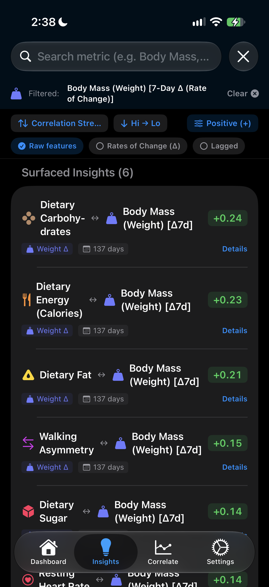
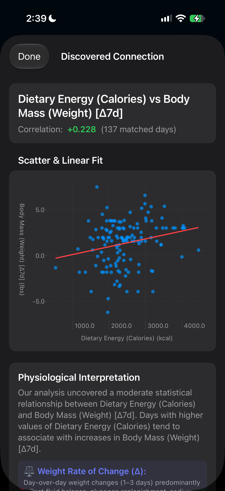

# Correlate: Apple Health Insights

Correlate is an iOS app that uncovers hidden connections in your Apple Health data. It tracks 25+ metrics, computes daily rates of change and time lags, and automatically surfaces statistically significant correlations between your habits and biological markers.

---

### Key Features

* **25+ HealthKit Metrics:** Ingests activity, nutrition, vitals, sleep stages, and body measurements.
* **Smart Time-Series Engine:** Computes rates of change (e.g. 7-day weight velocity) and time lags (e.g. yesterday's sleep vs. today's resting heart rate) with linear interpolation between intermittent weigh-ins.
* **Automated Insights:** Scans all feature combinations to rank meaningful correlations, automatically filtering out obvious pairs (like Steps vs. Distance).
* **Interactive Exploration:**
  * **Search & Filter:** Find connections by metric, polarity (+/-), or feature type (Raw, Rates of Change, Lagged).
  * **Swift Charts:** Responsive trends and scatter plots with best-fit linear regression lines fit to your data.
  * **Custom Correlation Tool:** Compare any two metrics or transformed features on demand.
* **Local & Private:** Runs entirely on-device and caches discoveries locally.

---

### Tech Stack

* **Platform:** iOS 16+ (Swift 5)
* **Frameworks:** SwiftUI, Swift Charts, HealthKit, Foundation

---

### Directory Structure

```plaintext
correlate-health/
├── CorrelateApp.swift            # App entry point & TabView navigation
├── HealthManager.swift           # HealthKit authorization & 25+ metric catalog
├── TimeSeriesTransforms.swift     # Interpolation, derivatives (Δ), and time lags (t-k)
├── ContentView.swift             # Main health metric dashboard
├── MetricGraphView.swift         # Dynamic trend charts & statistics
├── CorrelationView.swift         # Custom bivariate correlation tool
├── InsightsView.swift            # Automated correlation discovery engine
├── SettingsView.swift            # Preferences & privacy
├── Info.plist                    # HealthKit permissions
└── Assets.xcassets/              # App icons & accent colors
```

---

### Example Screenshots

<p float="left">


</p>

---
<p align="center">&copy; Copyright 2026 <a href="https://blakerayvid.com">Blake Rayvid</a>. All rights reserved.</p>