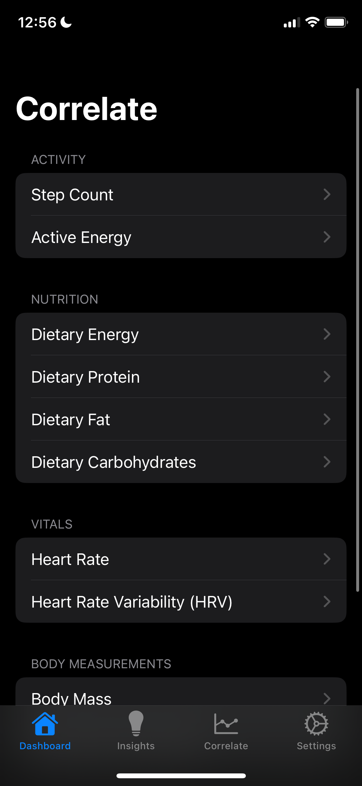
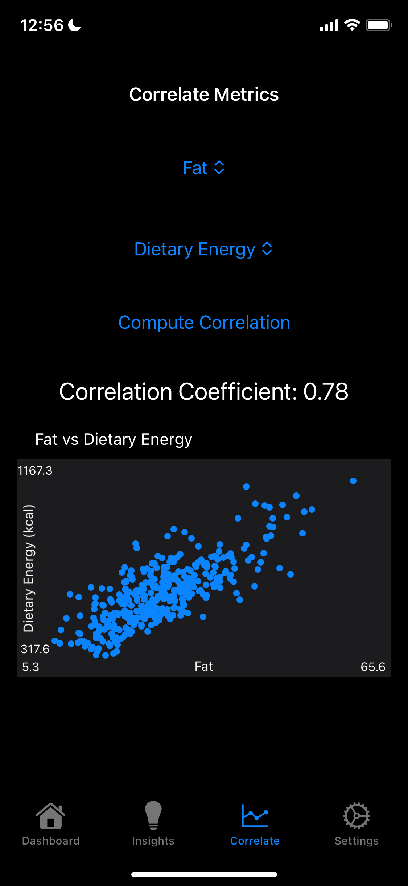

# Apple Health Insights App
<p float="left">


</p>

---

```plaintext
Correlate/
├── Correlate/
|     ├── CorrelateApp.swift     # App entry point with TabView setup
│     ├── HealthManager.swift    # Handles HealthKit authorization and data
│     ├── ContentView.swift      # Dashboard list of metrics
│     ├── MetricGraphView.swift  # Graph view with time granularity
│     ├── InsightsView.swift     # Placeholder for AI health insights
│     ├── CorrelationView.swift  # Placeholder for metric correlation tool
│     ├── SettingsView.swift     # User settings form
|     ├── Assets.xcassets/       # App icons and assets (Xcode-managed)
|     └── Info.plist             # App configuration and permissions
└── Correlate.xcodeproj/         # Xcode project file
```

---

## App UX Outline

### 1. **Onboarding (First Launch)**
**Goal:** Establish trust, show value, request permissions.

- **Welcome Screen**
  - Logo + tagline
  - CTA: “Discover the hidden patterns in your health”
  - Button: “Get Started”

- **Data Permission Setup**
  - Apple Health access — friendly step-by-step explanation:
    - “We only use the data you choose to share.”
    - Options with toggles: Sleep, Steps, Heart Rate, Workouts, etc.
    - Button: “Connect Apple Health”

- **Customization Questions (Optional)**
  - “What are your health goals?”
    - Boost energy / Improve sleep / Track patterns / Just curious
  - “How often do you want insights?” → Daily / Weekly / On demand

- **Preview Insight Example**
  - “On days when you walk 7,000+ steps, your sleep quality improves 22%”
  - Button: “Start Exploring”

---

### 2. **Home / Dashboard Screen**
**Goal:** Overview of your key health metrics + personalized insights.

#### Layout:
- 📊 **Dynamic Tile Cards**
  - Sleep: e.g. "7h 35m last night (↑ 12%)"
  - Steps: “6,842 (Goal: 8k)”
  - HRV: “58 ms (↓ Slightly)”

- 💡 **Insight of the Day**
  - AI-generated sentence: “This week, you’ve slept 45 minutes longer on days you avoided caffeine.”
  - Tap to expand > shows data-backed visualization

- 📈 **Correlate Button**
  - “Find Relationships Between Metrics”

- 🔍 **Search**
  - Search for terms like “mood,” “stress,” “energy,” or “sleep” to view related graphs and insights

---

### 3. **"Correlate" Explorer**
**Goal:** Explore how two or more metrics relate over time.

#### Flow:
- Step 1: Select Metric A (e.g. Sleep)
- Step 2: Select Metric B (e.g. Resting HR)
- 📈 Show dual-axis time series graph
- AI Analysis:
  - “There is a moderate inverse correlation (r = -0.42) between sleep and resting HR.”
  - “Stronger correlation observed on weekdays.”
- Optional filter: “Weekdays vs Weekends”, “When stressed”, “Workout days”

---

### 4. **Insight Feed**
**Goal:** Log of all discovered insights and user notes.

- Scrollable feed with timestamped insights
- Each insight card:
  - AI summary
  - View underlying data
  - Save / favorite
  - Add personal note
- Filter by tags: [Sleep], [Mood], [Fitness], [Nutrition]

---

### 5. **Settings/Profile**
**Goal:** User control + upgrade option.

- Edit goals / metrics tracked
- Export data (PDF, CSV)
- Privacy options (e.g., “Store data locally only”)
- “Upgrade to Pro” button:
  - Benefits: Long-term trends, unlimited correlations, export tools

---

## Enhanced UX

---

### ✅ New Data Types Available
- **Calories (Active + Total)**
- **Macros**: Protein, Carbs, Fat
- **Micronutrients**: Iron, Magnesium, Vitamin D, etc.
- **Water Intake**
- **Meal Timing (if logged)**

---

### 🔥 Updated UX Flow Highlights

---

### 📊 **Home Screen Updates**
- New Nutrition Card:
  - “Calories Today: 1,842 kcal (↓12%)”
  - Tap opens full Nutrition Summary screen
- AI Insight Example:
  > “Your sleep is deeper on days with higher magnesium intake.”
  > “On days with >70g protein, your resting HRV improves by 9%.”

---

### 📈 **Correlate Explorer**
**Updated Flow:**
- Metric A: “Sleep Quality”
- Metric B: “Carbohydrate Intake”

**Now Supports:**
- “How do carbs affect my energy levels?”
- “Does protein affect resting HR?”
- “Do low-calorie days impact mood?”

**Filters:**
- Macronutrient ranges
- Time of day eaten (morning-heavy vs. evening-heavy meals)

---

### 🧠 AI Nutrition Insights
Incorporated directly into daily + weekly summaries:
- “This week, your average protein intake was 92g. On these days, you reported higher mood scores.”
- “Sleep quality decreased on days with over 40g sugar intake.”

---

### 🧾 New Nutrition Screen
Accessible via home or nav bar:

#### Layout:
- **Overview**
  - Today’s calories & macros vs goals
  - Daily goal rings (like Apple Watch)
- **Macro Composition Chart**
  - Pie chart of Protein / Carb / Fat
- **Trends**
  - Line graph: Weekly sugar intake
  - Bar chart: Vitamin D vs Mood
- **AI Suggestions**
  - “Your iron intake has been low 5 of the last 7 days. Consider foods like spinach or lentils.”

---

### 🧪 Combo Features (Power Users)
- **"Auto-Discover Relationships" Button**
  - App runs background correlation analysis across *all* metrics (including nutrition) and surfaces interesting insights like:
    > “You sleep worse when you eat after 9pm.”
    > “Hydration >2.5L correlates with higher energy and fewer mood swings.”

---

### ⚙️ Settings Additions
- Enable/Disable nutrition tracking
- Set custom nutrition goals (if not using another app for this)
- Link third-party nutrition apps (MyFitnessPal, Cronometer, etc.)

---

### 💡 Monetization Boost:
Premium could now include:
- Advanced nutrient trend analysis
- Personalized meal suggestions based on your body’s past responses
- “Your data says X food helps you sleep. Want recipes?”